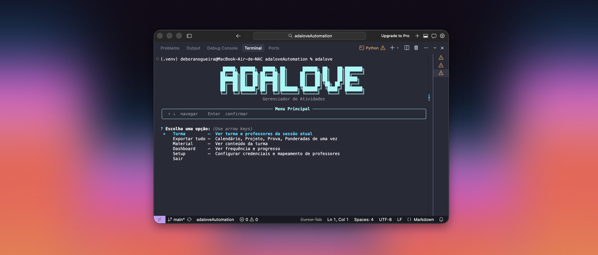
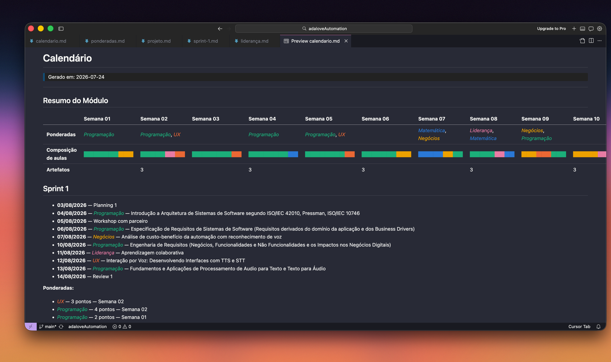
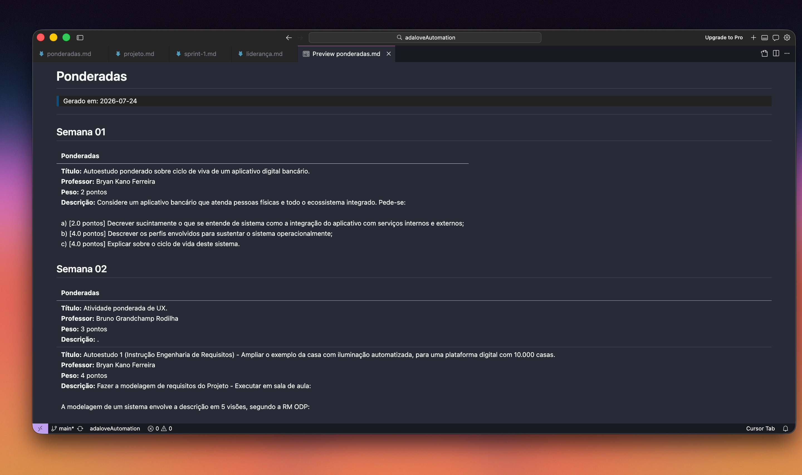
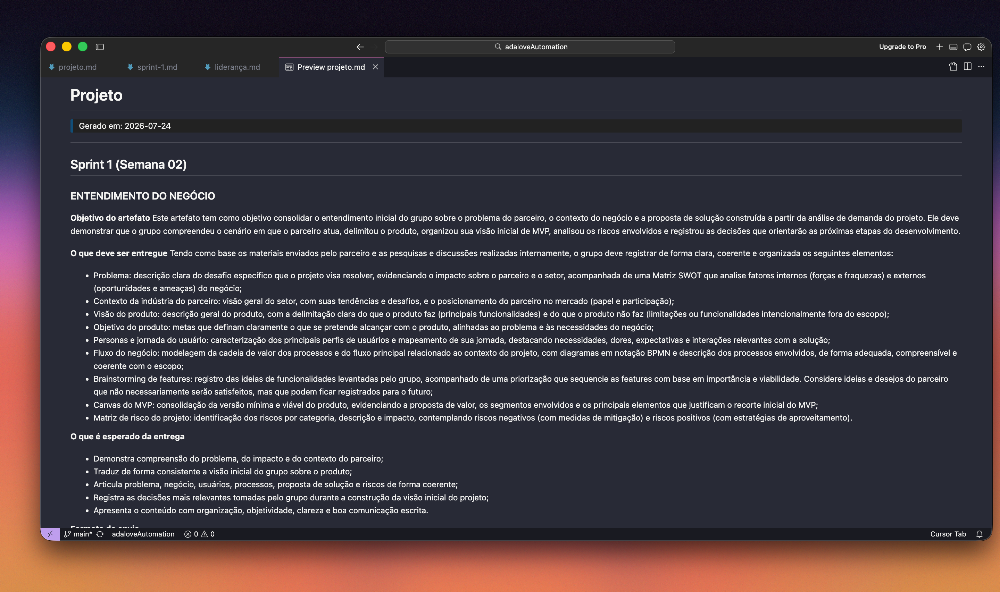
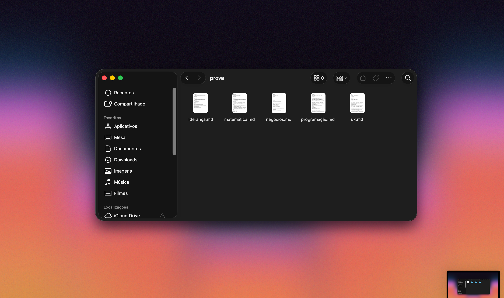

# Adalove CLI

A Adalove concentra todas as informações acadêmicas do módulo, mas nem sempre é fácil enxergar o panorama completo. Se você quiser organizar seu calendário, entender quais sprints vão exigir mais tempo ou simplesmente levar essas informações para o Notion, por exemplo, acaba precisando navegar por dezenas de cards e copiar tudo manualmente.

Foi dessa necessidade que surgiu o **Adalove CLI**. No começo, a ideia era simplesmente facilitar meu próprio planejamento de estudos, reunindo os materiais para a prova e me dando uma visão mais clara da carga de cada sprint. Com o tempo, outras funcionalidades foram sendo adicionadas, transformando a ferramenta em um apoio para acompanhar o módulo de forma mais simples.

Hoje, esse CLI se conecta diretamente à API da **Adalove** e reúne essas informações em um **dashboard interativo único** (`dashboard.html`), com abas para **Calendário** (encontros e ponderadas por sprint), **Projeto** (artefatos por sprint), **Prova** (assuntos e links das oito primeiras semanas, por disciplina), **Ponderadas** e **Turma**. Cada aba tem seu próprio botão discreto de exportação para baixar aquele conteúdo em **Markdown**, facilitando levar pra Notion, Obsidian, Claude, etc.



## O que você consegue fazer

| Opção do menu | O que gera | Output |
|---|---|---|
| **Abrir Dashboard** | HTML único com Calendário, Projeto, Prova, Ponderadas e Turma | `dashboard.html`, aberto direto no navegador |
| **Progresso** | Frequência e progresso acadêmico | só terminal |
| **Setup** | Credenciais e disciplinas | - |

Ao escolher **Abrir Dashboard**, o CLI abre um seletor de pasta nativo do macOS perguntando onde salvar o `dashboard.html` (se você cancelar, ele usa a pasta `output/` do próprio projeto) e já abre o arquivo sozinho no navegador padrão. A partir daí, cada aba tem seu próprio botão de exportação em Markdown — veja o formato de cada um em [`docs/identificacao-e-exportacao.md`](docs/identificacao-e-exportacao.md).

O filtro livre por semana/disciplina (antigo "Buscar") não está mais no menu interativo, mas continua disponível direto pelo comando `adalove fetch`.

### Prévia do conteúdo dos materiais

As imagens abaixo mostram o conteúdo em Markdown de cada material — mesmo formato usado tanto por `adalove fetch` quanto pelos botões "Exportar dados" de cada aba do dashboard.

**Calendário** — resumo do módulo por semana, encontros e ponderadas por sprint:



**Ponderadas** — título, professor, peso e descrição de cada atividade, por semana:



**Projeto** — artefatos de cada sprint:



**Prova** — assuntos e links por disciplina:



## Instalação

```bash
git clone <repo>
cd adaloveAutomation
python -m venv .venv && source .venv/bin/activate
pip install -e .

# recomendado: captura automática de credenciais pelo navegador
pip install playwright && playwright install chromium
```

## Uso

```bash
adalove          # menu interativo principal
adalove setup    # (re)configurar credenciais
adalove fetch    # ir direto pro filtro livre (Buscar)
```

Na primeira execução, escolha **Setup**. A partir daí, é só abrir `adalove` e navegar pelo menu — todas as opções acima ficam disponíveis ali.

Quer entender como cada atividade é identificada dentro do JSON da Adalove (e o que cada botão "Exportar dados" do dashboard gera)? Isso está documentado à parte em [`docs/identificacao-e-exportacao.md`](docs/identificacao-e-exportacao.md).

## Credenciais: como funciona por baixo dos panos

No seu primeiro acesso o Setup abre um navegador dedicado (via Playwright), separado do seu navegador do dia a dia, e nele:

1. Uma janela abre pedindo login — você loga normalmente (inclusive via Google).
2. O CLI navega até a página que dispara a chamada da API e intercepta a URL e o token automaticamente.
3. Da próxima vez, a sessão já está salva nesse perfil: a captura roda sozinha, sem precisar logar de novo.

Os tokens da Adalove expiram a cada 1 hora. Sempre que isso acontece, o CLI percebe e recaptura sozinho antes mesmo de tentar a requisição, você não vê erro nenhum, só uma mensagem avisando que está renovando.

Se preferir configurar manualmente (ex: Playwright não instalado):

1. Abra o Adalove no navegador e faça login.
2. Na aba **Rede** do DevTools, localize uma requisição para `apiv2.inteli.edu.br`.
3. Copie a URL completa e o valor do cabeçalho `Authorization`.
4. Execute `adalove setup` e cole os valores quando pedido.

## Estrutura dos arquivos gerados

Caso você não escolha uma pasta ao abrir o Dashboard, tudo cai em `output/<turma>/`, onde `<turma>` é o identificador que a própria Adalove usa pra sua sessão (ex: `2026-2A-T17`) — assim, o material de turmas diferentes nunca se mistura:

```
output/
  2026-2A-T17/
    dashboard.html          # Abrir Dashboard
    buscar/                  # adalove fetch
      <disciplina>_semana-<semanas>_<modo>.md
```

Os `.md` de cada aba (Calendário, Projeto, Prova, Ponderadas) não são mais gerados automaticamente nessa pasta — eles saem sob demanda, um de cada vez, pelo botão "Exportar dados" de cada aba do `dashboard.html`, e o navegador os baixa na pasta de downloads padrão dele (não em `output/<turma>/`). O formato de cada um continua o mesmo descrito em [`docs/identificacao-e-exportacao.md`](docs/identificacao-e-exportacao.md).

## Estrutura do projeto

```
adalove/
  api/         # cliente HTTP para a API da Adalove (adalove/api/client.py)
  browser/     # captura automática de credenciais via Playwright
  config/      # config.json, lista de disciplinas, cores e mapeamento de eixo
  filters/     # filtragem e classificação de atividades (semana, disciplina,
               # artefatos de projeto, ponderadas, encontros do calendário)
  models/      # Activity, SectionInfo, StudentStatus, DashboardMetrics
  writers/     # geração de cada arquivo Markdown de saída, e o dashboard.html (writers/html.py)
cli/
  main.py      # entry-point Typer com o menu interativo (Rich + questionary)
tests/         # testes unitários (pytest)
output/        # arquivos gerados (gitignored)
```

## Rodando os testes

```bash
pytest -q
```

## Créditos

Este projeto foi desenvolvido a partir da base disponibilizada por **Rafael Josué** em um repositório público próprio, que implementava a estrutura inicial do CLI (cliente da API, filtros e modelos) e o processo de captura de credenciais utilizando Playwright. A partir dessa fundação, expandi a solução, desenvolvendo a automação e as funcionalidades que compõem a versão atual do projeto.