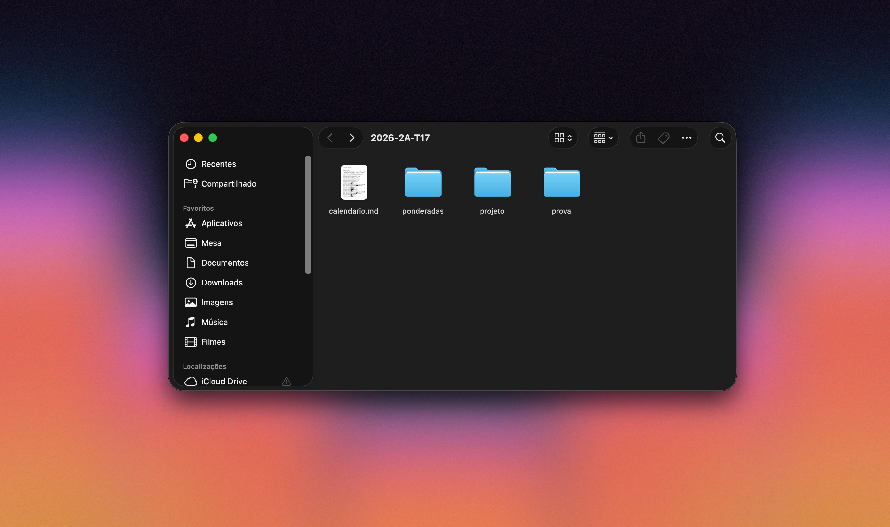
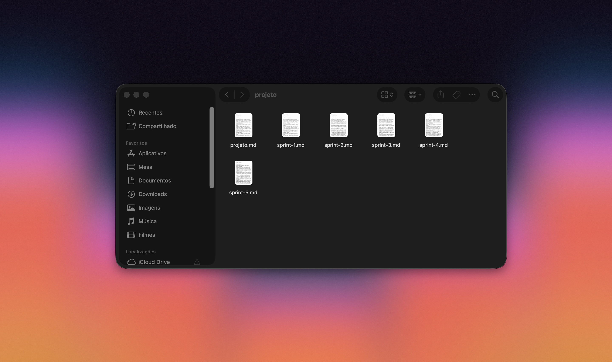
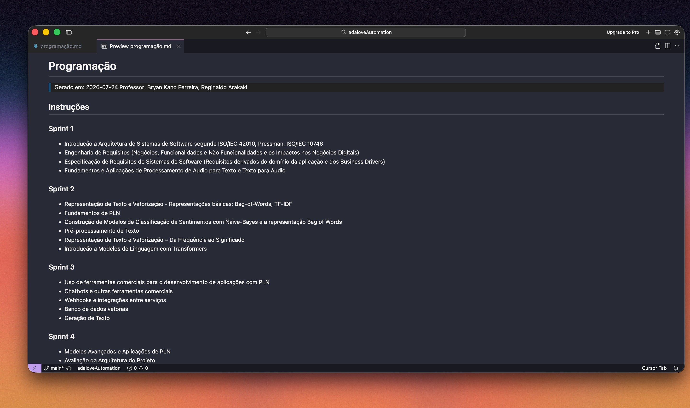

# Adalove CLI

A Adalove concentra todas as informações acadêmicas do módulo, mas nem sempre é fácil enxergar o panorama completo. Se você quiser organizar seu calendário, entender quais sprints vão exigir mais tempo ou simplesmente levar essas informações para o Notion, por exemplo, acaba precisando navegar por dezenas de cards e copiar tudo manualmente.

Foi dessa necessidade que surgiu o **Adalove CLI**. No começo, a ideia era simplesmente facilitar meu próprio planejamento de estudos, reunindo os materiais para a prova e me dando uma visão mais clara da carga de cada sprint. Com o tempo, outras funcionalidades foram sendo adicionadas, transformando a ferramenta em um apoio para acompanhar o módulo de forma mais simples.

Hoje, esse CLI se conecta diretamente à API da **Adalove** e reúne essas informações em uma visão consolidada e organizada. Em poucos segundos, você consegue gerar, por exemplo, o **Calendário de aulas e ponderadas**, separado por sprint, **Todos os assuntos e links de autoestudo** das oito primeiras semanas, facilitando a preparação para a prova, e a **Lista de todos os artefatos do projeto**, organizada por sprint. Todo o conteúdo gerado é exportado em **Markdown** para uma pasta de sua escolha, facilitando a organização em diferentes ferramentas como Notion, Obsidian, Claude, etc.


## O que você consegue fazer

| Opção do menu | O que gera | Output |
|---|---|---|
| **Turma** | Turma, módulo e professores | só terminal |
| **Exportar tudo** | Gera de uma vez as opções com \* abaixo| conjunto completo |
| **Material › Calendário** \* | Resumo do módulo por semana (ponderadas + composição por disciplina) + encontros por sprint | Um arquivo |
| **Material › Projeto** \* | Todos os artefatos do projeto | 6 arquivos (por sprint + unificado) |
| **Material › Prova** \* | Assuntos e links das 8 primeiras semanas | 5 arquivos (por disciplina) |
| **Material › Ponderadas** \* | Todas as ponderadas | Um arquivo |
| **Material › Buscar** | Filtro livre por semana/disciplina | por disciplina |
| **Dashboard** | Progresso acadêmico | só terminal |
| **Setup** | Credenciais e disciplinas | - |

Em qualquer exportação, o CLI abre um seletor de pasta nativo do macOS perguntando onde salvar os arquivos, se você cancelar, ele usa a pasta `output/` do próprio projeto. Ao final, a pasta escolhida já abre sozinha no Finder.

### Prévia dos materiais

**Calendário** — resumo do módulo por semana, encontros e ponderadas por sprint:


**Ponderadas** — título, professor, peso e descrição de cada atividade, por semana:


**Projeto** — artefatos de cada sprint:


**Prova** — assuntos e links por disciplina:


## Instalação

```bash
git clone <repo>
cd adaloveAutomation
python -m venv .venv && source .venv/bin/activate
pip install -e .

# recomendado: captura automática de credenciais pelo navegador
pip install playwright && playwright install chromium
```

## Uso

```bash
adalove          # menu interativo principal
adalove setup    # (re)configurar credenciais
adalove fetch    # ir direto pro filtro livre (Buscar)
```

Na primeira execução, escolha **Setup**. A partir daí, é só abrir `adalove` e navegar pelo menu — todas as opções acima ficam disponíveis ali.

Quer entender como cada atividade é identificada dentro do JSON da Adalove (e o que cada botão "Exportar dados" do dashboard gera)? Isso está documentado à parte em [`docs/identificacao-e-exportacao.md`](docs/identificacao-e-exportacao.md).

## Credenciais: como funciona por baixo dos panos

No seu primeiro acesso o Setup abre um navegador dedicado (via Playwright), separado do seu navegador do dia a dia, e nele:

1. Uma janela abre pedindo login — você loga normalmente (inclusive via Google).
2. O CLI navega até a página que dispara a chamada da API e intercepta a URL e o token automaticamente.
3. Da próxima vez, a sessão já está salva nesse perfil: a captura roda sozinha, sem precisar logar de novo.

Os tokens da Adalove expiram a cada 1 hora. Sempre que isso acontece, o CLI percebe e recaptura sozinho antes mesmo de tentar a requisição, você não vê erro nenhum, só uma mensagem avisando que está renovando.

Se preferir configurar manualmente (ex: Playwright não instalado):

1. Abra o Adalove no navegador e faça login.
2. Na aba **Rede** do DevTools, localize uma requisição para `apiv2.inteli.edu.br`.
3. Copie a URL completa e o valor do cabeçalho `Authorization`.
4. Execute `adalove setup` e cole os valores quando pedido.

## Estrutura dos arquivos gerados

Caso você não escolha uma pasta para receber os materiais solicitados, tudo cai em `output/<turma>/`, onde `<turma>` é o identificador que a própria Adalove usa pra sua sessão (ex: `2026-2A-T17`) — assim, o material de turmas diferentes nunca se mistura:

```
output/
  2026-2A-T17/
    calendario.md          # Material › Calendário
    projeto/                # Material › Projeto
      projeto.md
      sprint-1.md ... sprint-5.md
    prova/                  # Material › Prova
      matemática.md, programação.md, ...
    ponderadas/              # Material › Ponderadas
      ponderadas.md
    buscar/                  # Material › Buscar
      <disciplina>_semana-<semanas>_<modo>.md
```



Dentro de `projeto/` e `prova/`, um arquivo por sprint/disciplina, mais o consolidado:




## Estrutura do projeto

```
adalove/
  api/         # cliente HTTP para a API da Adalove (adalove/api/client.py)
  browser/     # captura automática de credenciais via Playwright
  config/      # config.json, lista de disciplinas, cores e mapeamento de eixo
  filters/     # filtragem e classificação de atividades (semana, disciplina,
               # artefatos de projeto, ponderadas, encontros do calendário)
  models/      # Activity, SectionInfo, StudentStatus, DashboardMetrics
  writers/     # geração de cada arquivo Markdown de saída
cli/
  main.py      # entry-point Typer com os menus interativos (Rich + questionary)
tests/         # testes unitários (pytest)
output/        # arquivos gerados (gitignored)
```

## Rodando os testes

```bash
pytest -q
```

## Créditos

Este projeto foi desenvolvido a partir da base disponibilizada por **Rafael Josué** em um repositório público próprio, que implementava a estrutura inicial do CLI (cliente da API, filtros e modelos) e o processo de captura de credenciais utilizando Playwright. A partir dessa fundação, expandi a solução, desenvolvendo a automação e as funcionalidades que compõem a versão atual do projeto.